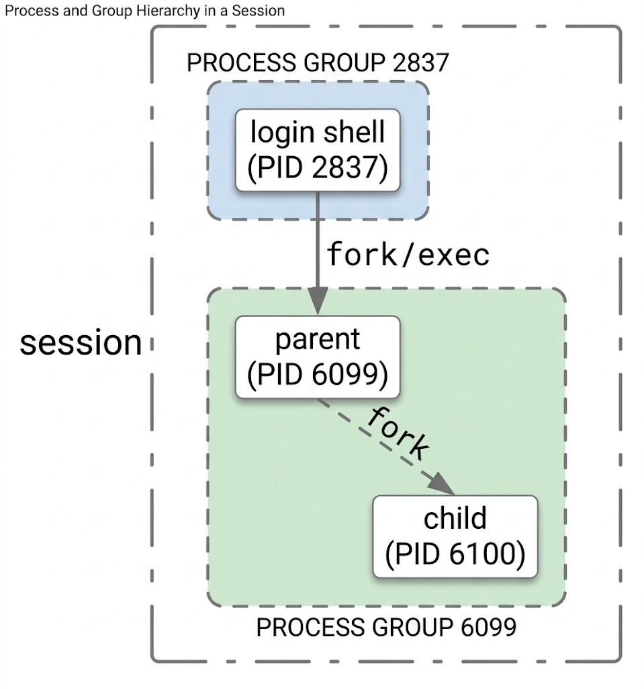
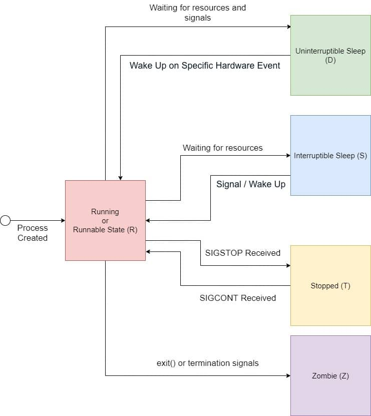
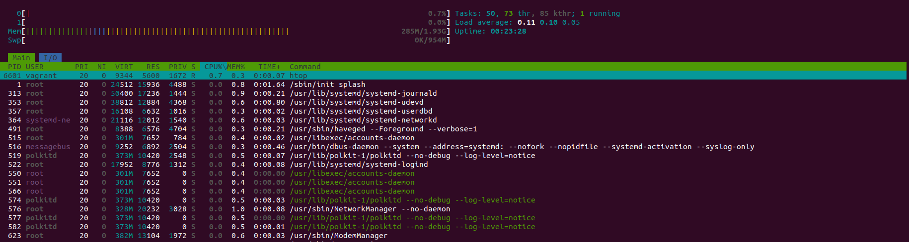
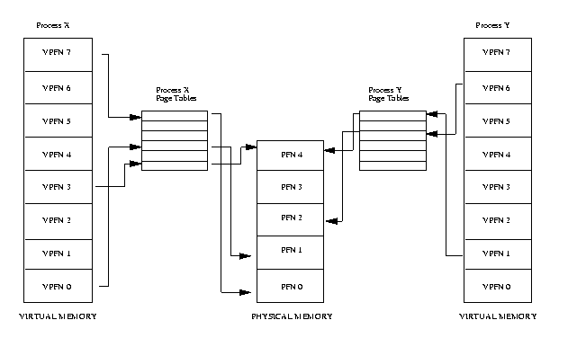

# The Linux Kernel

## Concepts

The Linux kernel is the main component of an operating system. Its primary function is to abstract the hardware and provide an API for interacting with it. Programming against this API allows us to write applications without worrying about where and how they are executed.

The basic Linux architecture is:

- **Hardware.** Components such as the CPU, memory, disk drives, network interfaces, and peripheral devices.

- **The Kernel.** The core of the operating system (OS).

- **User Space.** The area where most applications run, including OS components such as shells, utilities like ps or ssh, and graphical user interfaces.

Interfaces between layers:

- Between the kernel and user space, we have the interface called **system calls** or **syscalls** for short.

- Between the kernel and the hardware, we have a collection of individual interfaces, usually grouped by hardware.

Hardware access modes:

- **User mode** runs regular applications with slower execution but safer and more convenient abstractions.

- **Kernel mode** runs the core OS with full control over the hardware, faster execution, and limited abstraction.

**<u>Lab 1.1:</u> Getting hardware information**

- `dmidecode` provides information about the system's components.

```sh
┌──(vagrant㉿kalilinux)-[~]
└─$ sudo dmidecode 
# dmidecode 3.6
Getting SMBIOS data from sysfs.
SMBIOS 2.5 present.
10 structures occupying 456 bytes.
Table at 0x000E1000.

Handle 0x0000, DMI type 0, 20 bytes
BIOS Information
	Vendor: innotek GmbH
	Version: VirtualBox
	Release Date: 12/01/2006
	Address: 0xE0000
	Runtime Size: 128 kB
	ROM Size: 128 kB
	Characteristics:
		ISA is supported
		PCI is supported
		Boot from CD is supported
		Selectable boot is supported
		8042 keyboard services are supported (int 9h)
		CGA/mono video services are supported (int 10h)
		ACPI is supported

Handle 0x0001, DMI type 1, 27 bytes
System Information
	Manufacturer: innotek GmbH
	Product Name: VirtualBox
	Version: 1.2
	Serial Number: 0
	UUID: c1db5972-0e75-3844-bd36-4f10cfc7721f
	Wake-up Type: Power Switch
	SKU Number: Not Specified
	Family: Virtual Machine

Handle 0x0008, DMI type 2, 15 bytes
Base Board Information
	Manufacturer: Oracle Corporation
	Product Name: VirtualBox
	Version: 1.2
	Serial Number: 0
	Asset Tag: Not Specified
	Features:
		Board is a hosting board
	Location In Chassis: Not Specified
	Chassis Handle: 0x0003
	Type: Motherboard
	Contained Object Handles: 0

Handle 0x0003, DMI type 3, 13 bytes
Chassis Information
	Manufacturer: Oracle Corporation
	Type: Other
	Lock: Not Present
	Version: Not Specified
	Serial Number: Not Specified
	Asset Tag: Not Specified
	Boot-up State: Safe
	Power Supply State: Safe
	Thermal State: Safe
	Security Status: None

Handle 0x0007, DMI type 126, 42 bytes
Inactive

Handle 0x0005, DMI type 126, 15 bytes
Inactive

Handle 0x0006, DMI type 126, 34 bytes
Inactive

Handle 0x0002, DMI type 11, 7 bytes
OEM Strings
	String 1: vboxVer_7.0.26
	String 2: vboxRev_168464

Handle 0x0004, DMI type 128, 8 bytes
OEM-specific Type
	Header and Data:
		80 08 04 00 FF C5 2A 00

Handle 0xFEFF, DMI type 127, 4 bytes
End Of Table
```

- `lscpu` displays information about CPU architecture. We can get similar information from `/proc/cpuinfo`.

```sh
[vagrant@almalinux ~]$ lscpu 
Architecture:             x86_64
  CPU op-mode(s):         32-bit, 64-bit
  Address sizes:          39 bits physical, 48 bits virtual
  Byte Order:             Little Endian
CPU(s):                   2
  On-line CPU(s) list:    0,1
Vendor ID:                GenuineIntel
  Model name:             11th Gen Intel(R) Core(TM) i7-1165G7 @ 2.80GHz
    CPU family:           6
    Model:                140
    Thread(s) per core:   1
    Core(s) per socket:   2
    Socket(s):            1
    Stepping:             1
    BogoMIPS:             5606.39
    Flags:                fpu vme de pse tsc msr pae mce cx8 apic sep mtrr pge mca cmov pat pse36 clflush mmx fxsr sse sse2 ht syscall nx rdtscp lm constant_tsc rep_good nopl xtopology nonstop_tsc cpuid 
                          tsc_known_freq pni pclmulqdq ssse3 cx16 pcid sse4_1 sse4_2 x2apic movbe popcnt aes xsave avx rdrand hypervisor lahf_lm abm 3dnowprefetch pti fsgsbase bmi1 avx2 bmi2 invpcid rdse
                          ed clflushopt arat md_clear flush_l1d arch_capabilities
Virtualization features:  
  Hypervisor vendor:      KVM
  Virtualization type:    full
Caches (sum of all):      
  L1d:                    96 KiB (2 instances)
  L1i:                    64 KiB (2 instances)
  L2:                     2.5 MiB (2 instances)
  L3:                     24 MiB (2 instances)
NUMA:                     
  NUMA node(s):           1
  NUMA node0 CPU(s):      0,1
Vulnerabilities:          
  Gather data sampling:   Unknown: Dependent on hypervisor status
  Itlb multihit:          KVM: Mitigation: VMX unsupported
  L1tf:                   Mitigation; PTE Inversion
  Mds:                    Mitigation; Clear CPU buffers; SMT Host state unknown
  Meltdown:               Mitigation; PTI
  Mmio stale data:        Not affected
  Reg file data sampling: Not affected
  Retbleed:               Not affected
  Spec rstack overflow:   Not affected
  Spec store bypass:      Vulnerable
  Spectre v1:             Mitigation; usercopy/swapgs barriers and __user pointer sanitization
  Spectre v2:             Mitigation; Retpolines; STIBP disabled; RSB filling; PBRSB-eIBRS Not affected; BHI Retpoline
  Srbds:                  Not affected
  Tsx async abort:        Not affected
[vagrant@almalinux ~]$ cat /proc/cpuinfo 
processor	: 0
vendor_id	: GenuineIntel
cpu family	: 6
model		: 140
model name	: 11th Gen Intel(R) Core(TM) i7-1165G7 @ 2.80GHz
stepping	: 1
microcode	: 0xbc
cpu MHz		: 2803.198
cache size	: 12288 KB
physical id	: 0
siblings	: 2
core id		: 0
cpu cores	: 2
apicid		: 0
initial apicid	: 0
fpu		: yes
fpu_exception	: yes
cpuid level	: 22
wp		: yes
flags		: fpu vme de pse tsc msr pae mce cx8 apic sep mtrr pge mca cmov pat pse36 clflush mmx fxsr sse sse2 ht syscall nx rdtscp lm constant_tsc rep_good nopl xtopology nonstop_tsc cpuid tsc_known_freq pni pclmulqdq ssse3 cx16 pcid sse4_1 sse4_2 x2apic movbe popcnt aes xsave avx rdrand hypervisor lahf_lm abm 3dnowprefetch pti fsgsbase bmi1 avx2 bmi2 invpcid rdseed clflushopt arat md_clear flush_l1d arch_capabilities
bugs		: cpu_meltdown spectre_v1 spectre_v2 spec_store_bypass l1tf mds swapgs itlb_multihit gds bhi
bogomips	: 5606.39
clflush size	: 64
cache_alignment	: 64
address sizes	: 39 bits physical, 48 bits virtual
power management:

processor	: 1
vendor_id	: GenuineIntel
cpu family	: 6
model		: 140
model name	: 11th Gen Intel(R) Core(TM) i7-1165G7 @ 2.80GHz
stepping	: 1
microcode	: 0xbc
cpu MHz		: 2803.198
cache size	: 12288 KB
physical id	: 0
siblings	: 2
core id		: 1
cpu cores	: 2
apicid		: 1
initial apicid	: 1
fpu		: yes
fpu_exception	: yes
cpuid level	: 22
wp		: yes
flags		: fpu vme de pse tsc msr pae mce cx8 apic sep mtrr pge mca cmov pat pse36 clflush mmx fxsr sse sse2 ht syscall nx rdtscp lm constant_tsc rep_good nopl xtopology nonstop_tsc cpuid tsc_known_freq pni pclmulqdq ssse3 cx16 pcid sse4_1 sse4_2 x2apic movbe popcnt aes xsave avx rdrand hypervisor lahf_lm abm 3dnowprefetch pti fsgsbase bmi1 avx2 bmi2 invpcid rdseed clflushopt arat md_clear flush_l1d arch_capabilities
bugs		: cpu_meltdown spectre_v1 spectre_v2 spec_store_bypass l1tf mds swapgs itlb_multihit gds bhi
bogomips	: 5606.39
clflush size	: 64
cache_alignment	: 64
address sizes	: 39 bits physical, 48 bits virtual
power management:
```

### Kernel Components

- **Process management**, such as starting or terminating a process based on an executable file.

- **Memory management**, such as allocating memory for a process or mapping a file into memory.

- **Networking management**, such as managing network interfaces or providing the network stack.

- Filesystems, providing **file management** and supporting the creation and deletion of files.

- **Device management**, from character devices like keyboards to device drivers.

### Process Management

Concepts:

- A **process** is the user-facing unit based on an executable binary.

- A **thread** is a unit of execution within the context of a process.

- **Multithreading** means that a process has several parallel executions running at the same time, potentially on different CPUs.

Linux units:

- **Sessions.** Identified with a session ID (SID), they contain one or more process groups and represent a high-level user-facing unit, with an optional TTY attached.

- **Process groups.** Identified with a process group ID (PGID), they contain one or more processes, with at most one process group in a session as the foreground process group.

- **Processes.** Identified with a process ID (PID), they are abstractions that group multiple resources such as address space, one or more threads, sockets, and so on.

- **Threads.** Identified with a thread ID (TID) and thread group ID (TGID), they are implemented by the kernel as processes. A thread is a process that shares certain resources (such as memory or signal handlers) with other processes.

- **Tasks.** All of the aforementioned units are derived from and/or anchored in tasks; however, tasks are not exposed as such outside the kernel.

<p align="center">
  
</p>

**Process creation.** Processes are created using the following system calls:

- `fork()`: Creates a child process that is a copy of the parent process. The child process receives a new PID but inherits the parent's memory, file descriptors, and other attributes.

- `exec()`: Replaces the current process's memory space with a new program. This is often used after `fork()` to run a different program in the child process.

- `clone()`: Similar to `fork()`, but it provides more control over what is shared between the parent and child processes (for example, memory and file descriptors).

**Process states.** A process can be in one of the following states:

- **Running (R):** The process is currently executing. In the running state, each process takes up a CPU core and a portion of volatile memory to execute its code and logic.

- **Sleeping (S):** The process is waiting for an event or resource, such as an I/O operation or resource allocation. If the process must wait for a resource to become available before it can continue, it may enter the **uninterruptible sleep state (D)**.

	For example, when the network is slow or experiencing issues, a process waiting for a network read operation may enter the **uninterruptible sleep state (D)**.

	In contrast, a process that waits for an event or the availability of a resource and can react to that event may enter the **interruptible sleep state (S)**.

	For example, when a process waits for user input, it goes into the **interruptible sleep state (S)**.

- **Stopped (T):** The process has been paused (for example, by a signal such as `SIGSTOP` or `SIGTSTP`). While a process is in the stopped state, it can be resumed and returned to a running state.

- **Zombie (Z):** The process has completed execution, but its entry in the process table remains until the parent reads its exit status. This process is also known as a defunct process.

- **Terminated / Dead (X):** The process has finished execution, released all of its resources, and is no longer present in the process table.

<p align="center">
  
</p>

**<u>Lab 1.2:</u> Interacting with processes**

- `ps -ef` list every process on the system using standard syntax with full format:

```sh
[vagrant@almalinux ~]$ ps -ef | head -15
UID          PID    PPID  C STIME TTY          TIME CMD
root           1       0  0 00:58 ?        00:00:00 /usr/lib/systemd/systemd --switched-root --system --deserialize 31
root           2       0  0 00:58 ?        00:00:00 [kthreadd]
root           3       2  0 00:58 ?        00:00:00 [pool_workqueue_]
root           4       2  0 00:58 ?        00:00:00 [kworker/R-rcu_g]
root           5       2  0 00:58 ?        00:00:00 [kworker/R-sync_]
root           6       2  0 00:58 ?        00:00:00 [kworker/R-slub_]
root           7       2  0 00:58 ?        00:00:00 [kworker/R-netns]
root           9       2  0 00:58 ?        00:00:00 [kworker/0:0H-events_highpri]
root          10       2  0 00:58 ?        00:00:00 [kworker/u8:0-events_unbound]
root          11       2  0 00:58 ?        00:00:00 [kworker/R-mm_pe]
root          12       2  0 00:58 ?        00:00:00 [kworker/u8:1-netns]
root          13       2  0 00:58 ?        00:00:00 [rcu_tasks_kthre]
root          14       2  0 00:58 ?        00:00:00 [rcu_tasks_rude_]
root          15       2  0 00:58 ?        00:00:00 [rcu_tasks_trace]
```

Process with **PID 1** represents the **init process**.

- `top` and `htop` display information about the running processes in real-time, and additional information about the system such load average, uptime, total process by state, cpu and memory usage.

```sh
top - 21:20:21 up 20 min,  1 user,  load average: 0.08, 0.12, 0.05
Tasks: 138 total,   1 running, 137 sleeping,   0 stopped,   0 zombie
%Cpu(s):  1.5 us,  1.0 sy,  0.0 ni, 97.5 id,  0.0 wa,  0.0 hi,  0.0 si,  0.0 st
MiB Mem :   1971.7 total,    784.2 free,    439.9 used,    906.5 buff/cache 
MiB Swap:    953.7 total,    953.7 free,      0.0 used.   1531.8 avail Mem

    PID USER      PR  NI    VIRT    RES    SHR S  %CPU  %MEM     TIME+ COMMAND
      1 root      20   0   24512  15936  11448 S   0.3   0.8   0:01.52 systemd
      2 root      20   0       0      0      0 S   0.0   0.0   0:00.00 kthreadd
      3 root      20   0       0      0      0 S   0.0   0.0   0:00.00 pool_workqueue_release
      4 root       0 -20       0      0      0 I   0.0   0.0   0:00.00 kworker/R-rcu_gp
      5 root       0 -20       0      0      0 I   0.0   0.0   0:00.00 kworker/R-sync_wq
      6 root       0 -20       0      0      0 I   0.0   0.0   0:00.00 kworker/R-kvfree_rcu_reclaim
      7 root       0 -20       0      0      0 I   0.0   0.0   0:00.00 kworker/R-slub_flushwq
      8 root       0 -20       0      0      0 I   0.0   0.0   0:00.00 kworker/R-netns
     10 root       0 -20       0      0      0 I   0.0   0.0   0:00.00 kworker/0:0H-events_highpri
     11 root      20   0       0      0      0 I   0.0   0.0   0:00.26 kworker/0:1-ata_sff
```



### Memory Management

- Linux memory management subsystem is responsible, as the name implies, for managing the memory in the system. This includes implementation of virtual memory and demand paging, memory allocation both for kernel internal structures and user space programs, mapping of files into processes address space and many other cool things.

- Physical memory and virtual memory are divided into fixed-length chucks we called pages.

- Multiple virtual pages can point to the same physical page via their respective process-level page table. This is, in a sense, the core of memory management is how to effectively provide each process with the illusion that is page actually exists in RAM memory while using the existing space optimally.

- Linux memory management is a complex system with many configurable settings. Most of these settings are available via `/proc` filesystem and can be queried and adjusted using `sysctl`.

<p align="center">
  
</p>


**<u>Lab 1.3:</u> Memory management**

In orden to get information about memory, we can view the `/proc/meminfo` file.

```sh
┌──(vagrant㉿kalilinux)-[~]
└─$ sudo head -15 /proc/meminfo
MemTotal:        2019036 kB
MemFree:         1219180 kB
MemAvailable:    1605428 kB
Buffers:           28016 kB
Cached:           483216 kB
SwapCached:            0 kB
Active:           574672 kB
Inactive:          70420 kB
Active(anon):     138988 kB
Inactive(anon):        0 kB
Active(file):     435684 kB
Inactive(file):    70420 kB
Unevictable:           0 kB
Mlocked:               0 kB
SwapTotal:        976556 kB
```

With command `free -h` we get used memory and free memory in the system human readable:

```sh
┌──(vagrant㉿kalilinux)-[~]
└─$ free -h 
               total        used        free      shared  buff/cache   available
Mem:           1.9Gi       440Mi       948Mi       5.2Mi       755Mi       1.5Gi
Swap:          953Mi          0B       953Mi
```

Tip with `ps` command to get top 10 processes with more memory consuming:

```sh
┌──(vagrant㉿kalilinux)-[~]
└─$ ps aux --sort=-%mem | head -n 10
USER         PID %CPU %MEM    VSZ   RSS TTY      STAT START   TIME COMMAND
root        1972  0.0  5.3 405712 107016 tty7    Ssl+ 21:02   0:00 /usr/lib/xorg/Xorg :0 -seat seat0 -auth /var/run/lightdm/root/:0 -nolisten tcp vt7 -novtswitch
lightdm     2114  0.0  4.8 1233032 98600 ?       Ssl  21:02   0:00 /usr/sbin/lightdm-gtk-greeter
root         599  0.0  0.8 336668 17496 ?        Ssl  21:02   0:00 /usr/sbin/NetworkManager --no-daemon
root         311  0.0  0.8  50396 16280 ?        Ss   21:02   0:00 /usr/lib/systemd/systemd-journald
root           1  0.1  0.7  24524 15460 ?        Ss   21:02   0:01 /usr/lib/systemd/systemd --system --deserialize=141 splash
lightdm     2110  0.0  0.6 481572 14000 ?        S<sl 21:02   0:00 /usr/bin/wireplumber
lightdm     2039  0.0  0.6  22804 13316 ?        Ss   21:02   0:00 /usr/lib/systemd/systemd --user --deserialize=30
vagrant     2661  0.0  0.6  22684 13240 ?        Ss   21:03   0:00 /usr/lib/systemd/systemd --user --deserialize=30
root         346  0.0  0.6  38812 12700 ?        Ss   21:02   0:00 /usr/lib/systemd/systemd-udevd
```

### Networking

The linux network stack follow a layered architecture:

- **Sockets.** For abstracting communication.

- **Transmission Control Protocol (TCP) and User Datagram Protocol (UDP).** For connection oriented communication and connectioless communication, respectively.

- **Internet Protocol (IP).** For addressing machines.

#### OSI Layer model

The OSI (Open Systems Interconnection) Model is a conceptual framework created by the International Organization for Standardization (ISO) to describe how data is transmitted across a network using a structured seven-layer architecture.


| Layer | Working | Protocol Data Unit (PDU) | Protocols |
| --- | --- | --- | --- |
| Physical Layer | Establishes physical connection between devices and transmits raw bits over the medium. | Bits | USB, SONET/SDH |
| Data Link Layer | Provides node-to-node delivery and error detection/correction. | Frames | Ethernet, PPP, PPTP |
| Network Layer | Handles logical addressing and routing of data between different networks. | Packets | IP, ICMP, IGMP, OSPF |
| Transport Layer | Ensures end-to-end communication, segmentation, flow control, and error handling. | Segments (TCP) / Datagrams (UDP) | TCP, UDP, SCTP |
| Session Layer | Establishes, manages, and terminates communication sessions between applications. | Data | RPC |
| Presentation Layer | Translates, encrypts, and formats data for the application layer. | Data | TLS/SSL, MIME |
| Application Layer | Provides network services directly to end-user applications. | Data | FTP, SMTP, DNS, DHCP, NetBIOS |

